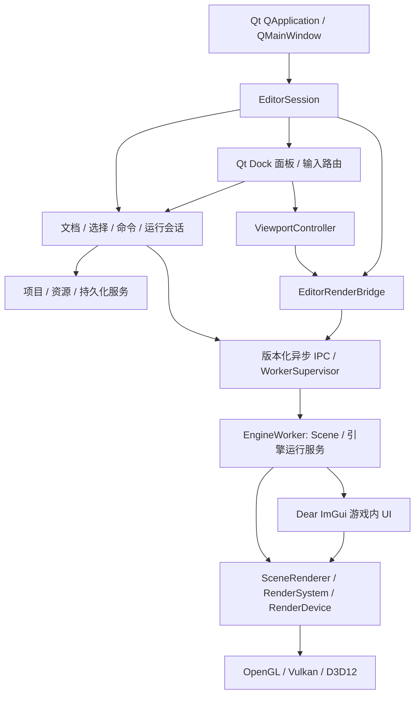

# 编辑器架构设计

## UI 技术选型（2026-10-24 已确定，迁移尚未实现）

新 EditorHost 使用 **Qt 6 Widgets**；Dear ImGui 用于 **游戏进程内 UI**。
主窗口、菜单、工具栏、停靠面板、Hierarchy、Inspector、Assets 和 Console 均用
Qt 构建，不再以 ImGui Docking 作为目标编辑器框架。现有 ImGui 编辑器仍可运行，
作为迁移基线保留；后续整体设计以本节选型为准。实施验收由
[编辑器 TODO](../../TODO/EditorArchitecture.md) 管理。

Host 使用 QApplication/QMainWindow、QDockWidget、QToolBar 和 QAction；树/列表
采用 Qt Model/View，模型数据来自 SceneDocument，编辑 delegate 通过命令服务
提交修改。Qt 组件只负责显示与输入，不能成为第二份权威文档或撤销历史。
QAction 的启用状态、快捷键、菜单和工具栏绑定同一编辑命令。

WorkerSupervisor 使用 QProcess 异步启动/观察 Worker，通过版本化 IPC 同步；
不在 UI 线程调用阻塞式 waitForFinished/waitForReadyRead。跨线程结果经 queued
信号送回 Host 主线程，在此更新模型和 QWidget。首版视口使用 QWidget 的
QPainter 绘制已完成 QImage，保留与当前图像匹配的缓冲所有权，不借用会被
Worker 覆盖的槽；不嵌入 Worker 原生窗口，不共享引擎设备或 fence。

SceneViewport 的选择框、网格和变换工具由 Qt Host 绘制与命中测试，输出编辑
命令后同步 Worker；这部分是待实施的 Qt Gizmo 工具，不能直接调用依赖 ImGui
draw list 的 ImGuizmo。已子模块化的 ImGuizmo/GizmoController 保持为旧编辑器
的过渡实现，Qt 迁移不撤销该依赖整理，也不在 Qt Host 隐藏嵌入 ImGui。
替代工具验收通过后，计划移除旧 GizmoController 及 ImGuizmo 子模块/构建依赖，
由[编辑器 TODO 的 E4-G](../../TODO/EditorArchitecture.md#e4-gqt-视口工具替代并移除-imguizmo计划)
跟踪。当前仅登记计划，现有所有权及运行行为不变。

Dear ImGui 的 context、NewFrame、绘制和 GPU 资源由游戏/Worker 的引擎运行时
管理。GameViewport 接收包括游戏 UI 在内的完成图像，Host 不再用 ImGui 绘制
周围面板。Qt 将聚焦 GameViewport 的鼠标、键盘、滚轮、文本提交和失焦通知
转换为协议输入；Worker 按游戏 ImGui 的 capture 状态决定是否继续交给游戏逻辑。
SceneViewport 工具输入与游戏输入分离，游戏 UI 不修改 Host 的选择与历史。

构建计划：Host 单独依赖 Qt6::Core/Gui/Widgets，Worker/游戏依赖 GEngine/ImGui，
两者只共用不含 Qt、ImGui、引擎头的协议 DTO。固定 Qt SDK 版本和 MSVC kit，
同时补 CMake、Premake 的生成工具/链接与部署规则，部署版本匹配的运行库和
平台插件。Qt SDK 环境尚未核验，也未添加构建目标；游戏/引擎独立构建不要求 Qt。

官方参考：[Qt 主窗口](https://doc.qt.io/qt-6/qmainwindow.html)、
[QProcess](https://doc.qt.io/qt-6/qprocess.html)、
[Qt CMake 集成](https://doc.qt.io/qt-6/cmake-get-started.html)。

## 已实施的 Gizmo 边界（2026-10-24）

`GEngine-Editor/src/UI/GizmoController` 已作为编辑器私有适配层实现；上游
ImGuizmo 只编译到编辑器，不再进入引擎 DLL。每次 OnImGuiRender 开始绑定
当前共享 ImGui context 并 BeginFrame 一次，SceneViewport 内选择当前 draw list
及图像区域。操作/空间显式映射，返回 Changed/Hovered/Active；仅 Changed
时写回变换。Grid 也走同一适配器。现有编辑器仍直接更新 Transform，命令
事务与独立 EditorHost 尚未实施。下文为整体提案，不能据此推断进程隔离已完成。

状态：**整体架构仍为提案，上节 GizmoController 已单独实施**。设计基于
2026-10-24 编辑器修复；本次子模块迁移不实施进程隔离。其他实施阶段由
[编辑器 TODO](../../TODO/EditorArchitecture.md) 管理；接口约定见
[Editor API 设计](../API/Editor.md)。

## 目标与现状

目标是让编辑器能可靠编辑、保存、运行和预览场景，并在引擎 API 或图形后端
变化时将影响限制在适配边界。优先保证数据不丢失、运行副本隔离和 GPU
资源安全，再扩展复杂工具。首轮保持单项目、单场景文档，采用独立引擎进程；
不引入插件 ABI、多用户协作、节点编辑器或新的通用反射系统。

现状依据：

| 源码 | 当前职责与问题 |
| --- | --- |
| `GEngine-Editor/src/GEngineEditorLayer.cpp/.h` | 同时管理文档路径、活动场景、Play/Pause、快捷键、相机、Gizmo、预览目标与最终呈现；状态切换依赖延迟函数。 |
| `Panel/Hierarchy.cpp/.h` | 同时包含树与属性编辑，保存 GameObject 选择，并通过友元访问 Scene 注册表；编辑缺少统一事务。 |
| `Panel/ContentBrowser.cpp/.h` | 浏览路径和资源预览放在面板中，缺少统一项目上下文。 |
| `GEngine/include/GEngine/Object/Scene/Scene.h` | GameObject 依赖 Scene 生命周期；删除延迟到帧末，已有 Scene::Copy，但没有完整的编辑文档或历史管理接口。 |
| 当前 RenderPreview | 在 CPU 变换顶点，逐次创建颜色预览绘制资源；不是完整材质/光照场景渲染器。 |

已有构建及有界运行记录见[修复 TODO](../../TODO/Build/ThirdPartyDependencies.md)。
画面、交互、长时间资源使用的未验证项不能因本设计而视为完成。

## 模块与依赖

采用 EditorHost 与 EngineWorker 两个进程；DLL 分层不能替代故障隔离。
EditorCore 不包含 Qt 控件、ImGui/ImGuizmo 或原生图形头；EditorUI 使用 Qt 6
Widgets，场景工具通过 Host 的 Qt 视口适配层使用。运行时引擎不依赖 Qt 编辑器。

跨进程箭头传输消息，不传递对象指针。Host 模型修改在 Host 主线程，Worker
场景更新和渲染请求在 Worker 的合法线程。
资源导入异步化放在 E5；只采用任务结果队列，不先引入全局事件总线。

| 模块 | 负责 | 不负责 |
| --- | --- | --- |
| EditorSession | 创建/销毁服务，协调帧边界、项目与退出流程 | 绘制属性控件、创建原生图形对象 |
| SceneDocument | 编辑场景、文件路径、修订号、保存点、命令历史 | 推进物理或脚本 |
| SelectionService | 当前对象/资源选择，验证与失效通知 | 延长已删除对象生命周期 |
| CommandHistory | 执行、撤销、重做与连续交互事务 | 接管运行场景中的游戏逻辑 |
| PlaySession | 运行副本、状态机、启动/停止与错误回滚 | 修改文档保存点 |
| PanelHost | 面板生命周期、布局、只读上下文和服务访问 | 直接拥有场景或 GPU 目标 |
| ViewportController | 相机、显示区域、DPI、可见性、Gizmo/拾取请求 | 分配原生描述符或等待 GPU |
| EditorRenderBridge | 组织视图请求与输出，复用场景渲染入口 | 修改场景文档、实现后端同步 |
| ProjectContext / AssetService | 项目根目录、路径解析、资源状态与导入结果 | 将 GPU 资源操作隐藏在任意工作线程 |

## 故障隔离与恢复（2026-10-24 新增硬性要求）

引擎进程崩溃不得结束编辑器进程。此要求覆盖编辑预览、Play、脚本、物理、
引擎反序列化、资源导入与 shader 编译等引擎代码路径；只隔离 Play 不够。
普通异常可转换成操作错误，但不能依靠 try/catch 或独立线程在内存破坏后
继续运行。实现工作及故障注入归 [E0](../../TODO/EditorArchitecture.md)。

EditorHost 拥有文档模型、选择、历史、项目路径和 UI；不链接/加载 GEngine
DLL，不执行用户原生脚本，不创建引擎 Scene。它采用 Qt 6 Widgets UI 与图像呈现，
不沿用当前依赖 GEngine Application/Layer 的启动和最终呈现路径。
这需要单独构建目标与类型边界；Host 数据类型不从 `<GEngine.h>` 引入。
EngineWorker 加载 GEngine，维护文档的可重建镜像，执行预览与运行；二者
共用版本化序列化 DTO/协议定义，不共享 C++ 对象、allocator 或 ECS 内存。
共享 SceneRenderer 指复用 Worker 内部实现，不是跨进程共享对象。

文档是 Host 的权威数据。编辑命令先在 Host 验证并写入历史，再发送带文档
revision 的镜像更新；Worker 错误只使镜像失效，不回滚已接受的用户修改。
Host 组件 schema/通用属性数据必须覆盖现有序列化字段，未知组件保留原始数据，
避免重存时丢失内容。引擎专有解析在 Worker 执行；Host 只处理受限、版本化的
中间格式并校验结果。导入先写暂存输出，成功后由 Host 提交资产引用。

WorkerSupervisor 独占子进程与 IPC 端点：启动完成握手后才可发送场景，核对
协议版本、构建标识和能力；每条消息带 session generation、request ID、文档
revision。对象 ID 与图像消息也限定在该会话，重启后拒绝旧回复。限制包长、
数组长度与队列容量；畸形消息返回错误/断连，不交给 UI 当作可信对象。
命令 ACK 表示镜像已应用，Ready/FrameReady 分别表示初始化和图像完成，不能混用。

Host 通过异步管道/本地 IPC 接收结果；不在 UI 线程同步等待 Worker。心跳和
请求各有有限截止时间，监控独立于引擎更新；超时标记 Unresponsive，停止
继续积压请求，允许用户终止并重启自己启动的 Worker。原生退出通知/IPC EOF
标记 Disconnected；记录 exit code、最后操作及可获得的崩溃日志/dump 路径。
进程启动失败或协议不兼容也保持编辑器可用。绝不终止外部用户进程。

首版视口传输使用后端内异步 GPU 读回 → 有界 CPU 图像缓冲 → Host QImage/
QPainter 显示，接受额外延迟和带宽成本，以获得可跨后端验证的边界。图像携带尺寸、
格式、行跨度、色彩约定、方向、generation/revision/frame ID；读取前检查
缓冲区边界，最多保留有限数量的最新完成帧，慢消费者丢旧帧。Host 只读取
完成发布的槽，Worker 崩溃时不等待未完成槽；可保留最后一帧并覆盖失联提示。
不让 Host 等待 Worker 的 GPU fence，也不在首版传输原生共享纹理句柄。
后续零拷贝需要独立的三后端能力与句柄失效设计，不属于当前阶段承诺。

重启生成新 session，重新握手并发送最新完整编辑快照，再继续增量同步。
编辑历史、dirty 状态和保存能力不依赖 Worker；运行状态不自动恢复，需用户
重新 Play。正常退出先发 Stop/Shutdown，有限等待后可终止所属子进程；随后
关闭管道/映射和进程句柄。异常退出直接回收 Host 所拥有的通信资源，Worker
地址空间与设备资源由进程退出处理，Host 不调用已崩溃进程的析构逻辑。

进程隔离防止引擎原生崩溃直接破坏 Host 内存，但 GPU 驱动重置、系统故障、
Host 自己的 UI/解析错误仍可能影响编辑器。Host 呈现设备丢失时目标是切到
无视口/重建呈现的可保存状态；不得宣称 GPU 故障完全隔离。验收分别记录
普通 Worker crash、hang、IPC 错误与设备丢失的表现。

原文中 SceneDocument/PlaySession 的职责继续有效，但涉及 Scene 强引用、
直接借用场景和 GPU 帧的部分仅在 Worker 内成立；Host 用 DTO 和异步消息替代。
当前同进程修复保留为迁移基线，**不满足本节的隔离验收**。

## 文档与 Worker 镜像引用

EditorSession 独占 SceneDocument、PlaySession、PanelHost 和各服务。SceneDocument
持有独立于引擎的编辑数据模型；Worker 持有预览 Scene 与运行副本。面板不持有 Scene
或 GameObject 长期引用，只接收本次调用有效的只读视图和对象标识。

对象引用使用 DocumentId + SceneGeneration + 对象持久 ID。当前 CreateGameObject
提供 uint32_t UUID 路径，但实现时必须验证序列化保存与复制语义；文档 ID、
generation 和查询接口是新增工作，不能假定已有。打开/替换/关闭场景递增
generation；每次使用时解析与检查，删除后立即使 UI 选择失效。
运行对象另带 PlaySession generation，禁止仅凭对象 UUID 将运行选择解析到编辑场景。

CPU 所有权与 GPU 完成分开：Worker 内 RenderBridge 持有视口输出的逻辑引用；录制/提交
持有真实 GPU 资源直到所涉及队列的提交 serial 完成。面板关闭不等于可立即
释放纹理，游戏 ImGui 纹理 ID 仍按当前帧获得，不跨帧缓存；Qt Host 只消费完成图像。

## 文档与编辑事务

面板读取 Host 文档快照/查询视图，提交意图给命令服务；不直接访问 EnTT 注册表。
先支持显式组件编辑器和类型化命令，不为此重写 ECS。引擎只补必要的稳定查询
与对象恢复能力，头文件和实现在既有对应目录下。

命令包含目标 ID、验证条件、执行与逆操作数据。创建/删除/复制、组件增删、
属性修改均走同一通道；删除命令保存可恢复组件数据及关联关系，不能只保存
失效的 GameObject。重做创建必须恢复原 ID 或显式修正引用。无法完整恢复的
组件先禁用该操作并给出原因，不能宣称支持撤销。

Gizmo/属性拖动采用 Begin → Preview → Commit/Cancel：交互期间可更新编辑
预览，结束只产生一个历史记录，Cancel 恢复原值。拖动期间目标删除、换场景
或进入 Play，先取消事务。跨字段修改原子提交，验证失败不留下半个变更。
新命令截断 redo 分支；保存点以历史状态标识记录，不能只依赖递增计数器。
直接导入/外部重新载入形成明确的历史屏障并使文档标脏或重建保存点。

新建、打开、切项目、退出遇到未保存修改统一经过 Save / Discard / Cancel。
打开先解析到候选 Scene，通过格式/引用校验后才替换文档；保存先写同目录
临时文件并验证成功，再执行可报告失败的替换。取消对话框、写盘失败或
反序列化异常都保留旧文档、路径及保存点。原文件格式在首轮不变。

## Play 状态机

对外展示 Edit、Starting、Playing、Paused、Stopping、Disconnected；Starting/Stopping 禁止
重复切换。请求排队到安全帧边界执行，不在面板绘制或场景遍历中替换场景。

| 事件 | 来源 → 结果 | 规则 |
| --- | --- | --- |
| Play | Edit → Starting → Playing | 提交/取消编辑事务；复制编辑场景；建立运行服务；启动成功才发布运行场景。 |
| Pause | Playing → Paused | 逻辑与物理同时暂停；UI、相机和呈现继续。 |
| Resume | Paused → Playing | 恢复同一运行副本，不重新复制编辑场景。 |
| Stop | Playing/Paused → Stopping → Edit | 停止新更新，清理运行脚本/物理与选择，再释放运行场景；GPU 使用独立退休。 |
| 启动失败 | Starting → Edit | 清理部分初始化资源，保留编辑文档，诊断错误可见。 |
| Worker 退出/失联 | 任意连接状态 → Disconnected | 保留文档与历史，停止运行输入，视口标明失联，提供重启；不在 Host 执行 Worker 清理代码。 |

Play 期间编辑文档默认只读，Inspector 明确显示运行实例；运行属性修改不进
编辑历史，Save 仍保存编辑文档。首轮不支持将运行变化应用回文档，也不提供
尚无引擎契约的单步按钮。关闭/换场景先停止 Play，再执行文档关闭流程。
当前 Scene 生命周期不具备完整显式停止接口，E3 必须核实析构、脚本与物理
清理路径，并补齐能力后才能承诺重复启动可靠。

## 视口、渲染与帧顺序

SceneViewport 请求编辑相机与工具覆盖层；GameViewport 请求运行相机或编辑
场景主相机。两者共用 SceneRenderer 的场景提取、材质和绘制能力。引擎拥有
SceneRenderer，编辑器只传场景只读数据、相机和可选调试输出，不把选择状态
写入游戏组件。引擎现有组件渲染帮助路径仍与 presentation 绑定；不能直接
假定可作为任意离屏渲染入口。E4 需要先建立并验证目标无关的场景绘制契约。

建议通过引擎现有 RenderSystem/RenderGraph 集成，不创建编辑器专属帧调度器。
在迁移完成前，EditorRenderBridge 封装当前颜色预览并明确报告能力缺口。
资源缓存按网格版本、材质版本及目标兼容性失效，避免每物体每帧重建 pipeline；
缓存实现必须在所有权与依赖验证之后进行。

以下为 Worker 内部渲染顺序的逻辑参考；Host 独立绘制 UI，通过 IPC 接收
已完成图像，不能为等待 Worker 帧阻塞消息循环。原先同进程 UI 采样/最终
呈现步骤仅适用于当前实现，隔离后由下节的图像传输取代：

1. 引擎获取可用帧槽；EditorSession 接收上帧 UI 请求、完成待决文档/Play 转换。
2. 路由输入，推进允许更新的运行场景，应用安全的编辑命令。
3. 生成本帧视口渲染请求，使用上次布局提交的物理像素尺寸；首次显示可延后一帧。
4. 声明/录制场景离屏工作；ImGui 布局收集下一帧尺寸与本帧交互意图。
5. UI 采样场景颜色目标，最终呈现采样 UI 目标；依赖和布局转换由引擎处理。
6. 帧末完成延迟删除、事务结束与资源退休；UI 产生的场景替换请求等到安全边界。

Worker 游戏图像的 GPU 依赖为：SceneColor 写 → 游戏 ImGui 合成 → 完成图像读回；
SceneViewport 不含编辑器面板。Qt Host 收到完成图像后独立绘制，不加入 Worker
的 GPU graph。此前 SceneColor → UITarget → Present 路径只描述旧编辑器。
所有用途写入资源描述；跨队列提交需要等待相应 serial，不以 CPU 引用计数
或可复用 fence 句柄推断完成。resize 先创建新目标，成功后切换，旧目标随
GPU 完成退休；失败显示诊断并保留可用旧目标。零尺寸/最小化暂停该视图工作，
恢复时重建；正常帧禁止用 device-wide wait 掩盖生命周期错误。

坐标统一分为 UI 逻辑坐标、视口物理像素、相机裁剪坐标和纹理 UV。DPI 转换
只发生一次；相机/世界坐标不为修正图片翻转而改变。游戏 ImGui 使用 GUIUtils
后端 UV 约定；Worker 图像传输约定统一为顶部起始行，Qt 按图像元数据呈现。
Qt Gizmo 使用显示区域的逻辑矩形，
拾取使用图像区域到物理像素的映射；非对称测试图形验证方向，中心方块不足以验证。
首轮保留树选择；GPU 拾取仅在明确支持 ID 输出和异步读回时启用，未支持时
明确显示能力限制，不通过同步 GPU 等待模拟可用。

## 输入、面板与资源服务

Host 输入按 Qt 模态对话框 → 文本控件/输入法 → Gizmo 活跃交互 → 已捕获的视口
相机/游戏输入 → 编辑器全局命令的优先级处理。点击视口建立焦点，鼠标离开
后拖动捕获持续到释放；失焦必须清除捕获与按键状态。游戏输入仅投递给聚焦
GameViewport，编辑相机只接收 SceneViewport 输入。快捷键绑定命令 ID，菜单
和工具栏调用同一命令及可用性查询，不各自实现 Play/Save 等逻辑。

HierarchyPanel、InspectorPanel、ContentBrowserPanel、SceneViewportPanel、
GameViewportPanel、ToolbarPanel、DiagnosticsPanel 经 PanelHost 获取窄接口。
Qt 布局通过 QMainWindow saveState/restoreState 与窗口 geometry 单独保存；
保留旧 imgui.ini 供过渡编辑器使用，不直接转换为 Qt dock 状态。布局恢复失败
可重置，不改场景数据。
关闭视口只停止该视图请求，不销毁文档或运行会话。

ProjectContext 区分引擎内置资源、项目 Assets、导入缓存和用户偏好路径；
序列化项目相对路径，不依赖启动目录。Backend/frames-in-flight 等重启配置
与窗口即时设置分开。首轮使用现有资源加载器的适配服务，不声称已有完整资源数据库。
导入结果携带项目 generation、请求 ID 和资源版本；旧项目结果直接丢弃。
工作线程只做允许的 CPU/文件任务，GPU 上传由设备规定的线程/队列执行。
诊断包含操作、资源路径、后端和可恢复状态；失败不会静默创建空资源。

## 目录、迁移与验收

建议编辑器目录：`src/App`（生命周期）、`src/Core`（Session/Document/Commands/
Selection/Play）、`src/Panels`、`src/Viewport`、`src/Services`、`src/UI`。
先按模块拆文件，只有复用/测试证据需要时再拆独立库。通用 SceneRenderer、
共享渲染等引擎设施保持 `GEngine/include` 与 `GEngine/src` 对应结构；GizmoController
保留在编辑器 UI 目录，不进入引擎公共头。
CMake 与 Premake 的文件发现、链接和启动路径同步迁移。

实施顺序与每阶段验收见 [E0–E6](../../TODO/EditorArchitecture.md)。推荐第一
里程碑先完成 E0 的最小故障隔离原型，再做 E1 的文档所有权、选择和文件操作；
不要同时重写渲染器和命令历史。迁移中旧面板经适配器访问新服务，逐项删除
直接修改路径；同一操作只能有一个权威实现。

验证至少覆盖：文档失败/取消和保存点、命令往返、对象失效、Play 循环与失败
回滚、输入冲突、场景/游戏视口切换。文档与命令核心采用不依赖 GUI 的回归
检查；编辑器本身作为交互示例，README 记录启动、可见结果与失败指示。
共享渲染接口改动另需实际调用该接口的 Example。

OpenGL、Vulkan、D3D12 分别在 Debug/Release 验证不对称图形方向、材质支持、
连续 resize、最小化/恢复、关闭面板、Play/Stop、退出顺序和多帧资源增长；
记录后端验证输出、CPU/GPU 资源计数和不可测项。有界运行或编译成功不能替代
可见结果和输入测试。新能力不支持时返回明确状态并禁用对应操作。

隔离验收额外在 Worker 初始化、预览渲染、导入及 Play 中注入访问冲突/abort，
并测试强制退出、无限循环、断管、错误协议版本、畸形包和旧帧回复。每次验证
Host 保持响应、未保存数据与 Undo 保留、Save 成功、Worker 可重启并恢复最新
编辑镜像；重复循环核对进程、句柄、图像缓冲和 GPU 资源无持续增长。

当前没有新增公共引擎接口、格式迁移或运行时行为；以上名称均为设计模块。
Gizmo 子模块迁移与旧转发方案的替代记录见[依赖跟踪](../../TODO/Build/ThirdPartyDependencies.md#planned-engine-owned-gizmo-forwarding-interface)。
