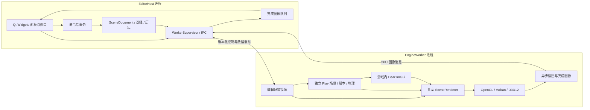

# Qt 6 编辑器目标架构

版本：2026-10-24。状态：**设计提案，尚未实现**。

本文件是新编辑器的目标架构入口，整合并替代 [旧方案](Editor.md) 中的目标
设计；旧文件保留当前 ImGui 编辑器的事实与设计历史。实施任务统一由
[编辑器 TODO](../../TODO/EditorArchitecture.md) 的 E0–E6、E4-G 管理，
协议和模块契约见 [Qt 编辑器 API 设计](../API/QtEditor.md)。本文不授权额外实现。

## 1. 已确定的方向与当前基线

| 决策 | 目标 |
| --- | --- |
| 编辑器界面 | Qt 6 Widgets，负责全部编辑器窗口、面板和视口工具。 |
| 游戏界面 | Dear ImGui，在游戏/EngineWorker 内执行与绘制。 |
| 故障边界 | EditorHost 与 EngineWorker 分进程；引擎崩溃后编辑器仍可编辑、撤销、保存与重启引擎。 |
| 场景权威数据 | Host 文档模型；Worker 场景只是可重建镜像。 |
| 视口传输 | 首版传输已完成 CPU 图像，Qt 独立显示，不跨进程共享 GPU 对象。 |
| 变换工具 | Qt Host 实现，功能验收后移除 ImGuizmo，不在 Qt Host 嵌入 ImGui。 |
| 初始范围 | 单项目、单场景文档、一个所属 Worker；多文档、插件 ABI、协作编辑和零拷贝不在首轮范围。 |

当前实际实现仍是 `GEngine-Editor/src/GEngineEditorApplication.cpp` 继承
GEngine Application，并由 EditorLayer 管理面板、场景、Play 与渲染；它不具备
进程隔离。现有 GizmoController 已隔离第三方调用，但依赖 ImGui 和引擎数学
类型，不能直接作为新 Host 的接口。旧颜色预览也不是完整的材质渲染器。

Qt `qtbase` 源码已固定在 `GEngine/GEngine-ThirdParty/qtbase`：v6.10.3，
`7ddbc87d8e14ce51d2957ea72d0a6077593d5ff4`，包含 Core/Gui/Widgets。
源码统一存放在聚合仓库不意味着引擎依赖 Qt；Qt SDK 构建、Host 程序和部署
仍未实现。已有 ImGui 编辑器构建/运行记录不能作为 Qt 编辑器的验证结果。

## 2. 进程、构建目标与依赖

计划形成三个目标，名称可在实现时按仓库惯例调整：

| 目标 | 直接依赖 | 禁止依赖 |
| --- | --- | --- |
| EditorHost | Qt6::Core/Gui/Widgets、EditorCore、协议编解码适配器 | GEngine DLL、用户原生脚本、ImGui/ImGuizmo、引擎 Platform 头 |
| EditorCore / Protocol | 标准 C++ 数据类型、文档与命令逻辑；共享协议结构与测试向量 | QWidget、QObject 生命周期、引擎 Scene/GameObject、GPU 原生对象 |
| EngineWorker | GEngine、Dear ImGui、Worker 协议适配器 | Qt Widgets、编辑器面板、Host 文档对象 |

不把 Qt 类型、`Ref<Scene>`、ImGui ID 或矩阵对象的内存布局作为协议。
矩阵按固定元素顺序编码并标注约定；Host 可有独立数学实现，不为数学函数加载
引擎 DLL。运行时引擎不反向依赖编辑器，普通游戏构建无需 Qt 安装。

Qt/系统故障可能影响 Host；本设计保证的是引擎进程故障不直接破坏 Host
地址空间。GPU 驱动重置和 Host 自身缺陷需要单独验证，不能以进程隔离替代。

## 3. Host 模块与所有权

EditorSession 协调项目、文档、运行会话和服务，Qt QObject 父子关系仅管理 UI
对象，不能代替文档所有权。EditorCore 不依赖 Qt，Qt adapters 负责信号和控件。

| 模块 | 权威状态与职责 |
| --- | --- |
| ProjectContext | 项目根目录、资源/缓存路径及项目 generation。 |
| SceneDocument | 对象/组件数据、持久 ID、路径、revision、保存点；不推进脚本和物理。 |
| CommandService / History | 验证修改、执行/撤销/重做、拖动事务、dirty 状态。 |
| SelectionService | 文档限定的对象/资源 ID，删除或换文档时立即失效。 |
| PlaySessionProxy | 用户运行意图与 Worker 已确认状态，运行实例快照。 |
| WorkerSupervisor | 子进程、连接 generation、异步请求、超时与重启。 |
| ViewportController | 相机、图像区域、DPI、输入捕获、Qt Gizmo 与视图 revision。 |
| AssetService / Diagnostics | 导入请求、可提交资产结果、结构化错误与日志。 |

对象引用包含 DocumentId、DocumentGeneration、ObjectId。当前 Scene 有
uint32_t UUID 路径，但查询、复制与序列化一致性仍需实现阶段核对；不能假定
已有完善的稳定引用系统。运行对象另带 SessionGeneration，不能用同一 UUID
把运行实例误解析为编辑对象。面板不持久保存 GameObject 或组件引用。

## 4. Qt 界面结构

QApplication 驱动 Host 事件循环，QMainWindow 管理菜单、QToolBar、状态栏与
QDockWidget；中间为 Scene/Game 视口，其他面板可停靠或浮动。

| 面板 | 数据来源与交互 |
| --- | --- |
| Hierarchy | Qt Model/View 展示文档对象，搜索和选择经 SelectionService。 |
| Inspector | 类型化属性控件/delegate，修改经 CommandService，不直接写 Worker。 |
| Assets | 项目资源查询、导入状态和拖放意图，不由控件自行改路径或加载引擎资产。 |
| SceneViewport | Worker 编辑镜像图像 + Host 相机/选择/Gizmo 覆盖层。 |
| GameViewport | Worker 运行图像及游戏 ImGui，仅聚焦时接收游戏输入。 |
| Console / Diagnostics | 区分 Host、Worker、脚本与后端日志，提供来源和关联请求。 |

QAction 的菜单、快捷键、工具栏共用一份命令与可用性判断。Qt item model
只是文档的投影；delegate 必须提交编辑命令。只保留 EditorCore 的历史，不
并行维护独立 QUndoStack。Qt UI 修改在主线程，后台解析结果经 queued 通知
回到主线程。布局独立保存 geometry、dock state 与版本；不把旧 imgui.ini
转换为 Qt 布局，也不改动用户已有布局。

## 5. 文档、撤销与磁盘保存

SceneDocument 是 Worker 断连时仍可保存的独立模型，不能把保存实现成 RPC。
新建/打开先产生候选文档，验证通过后才替换；打开失败不破坏旧场景。Host
需要独立的文档编解码适配器，保留现有 `.GEScene` 中的未知字段/组件。
现有 Serializer 依赖引擎 Scene，不能直接搬入 Host；E1 通过往返样本验证
兼容性，不在本设计中切换文件格式。遇到无法保留的数据必须拒绝破坏性保存。

命令保存可拥有的目标标识、前后值和逆操作数据。删除/组件移除需要可恢复
快照及引用关系；创建的重做须恢复相同 ID 或明确修正引用。验证失败不留下
半个变更，也不进入历史。新命令截断 redo 分支，保存点按历史状态标识记录。

连续交互采用 Begin → Preview → Commit/Cancel：文档可实时更新，松开后只
追加一个历史条目；Escape、失焦、删除目标、换文档或进入 Play 取消事务。
预览变更也带单调同步 revision，Cancel 发送恢复状态；历史保存点与同步
revision 分开，避免撤销/取消导致 Worker 顺序倒退。

保存使用同目录临时输出，写入与检查成功后替换原文件；失败保留原文件和
保存点。新建、打开、切项目、退出统一处理 Save/Discard/Cancel。导入与
外部重新加载形成显式历史屏障，不暗中清空或伪造撤销记录。

## 6. Worker 与运行状态

Worker 在自身合法线程将文档 DTO 转为编辑 Scene 镜像，在安全帧边界应用
修改。场景初始化、脚本、物理、资产引擎解析和 shader 编译均在 Worker，
不在 Host 动态加载可执行引擎代码。资产导入到临时位置，成功后 Host 才提交
引用；崩溃产生的半成品不替换项目正式资源。

进程连接状态和游戏状态分开：

| 状态机 | 状态与规则 |
| --- | --- |
| WorkerSupervisor | Stopped → Starting → Ready；失败/退出变 Disconnected，超时变 Unresponsive；重启创建新的 generation。 |
| PlaySession | Edit → StartingPlay → Playing ⇄ Paused → StoppingPlay → Edit；只在 Ready 时可请求启动。 |

Play 以已确认同步的文档 revision 创建独立运行 Scene，启动成功才返回 Playing。
暂停同时停止游戏逻辑与物理，呈现继续；Stop 在 Worker 清理脚本/物理与运行
引用。现有 Scene 没有完整显式停止契约，E3 必须核实部分初始化和析构路径。
首轮不提供未验证的单步或“应用运行变化回编辑场景”。

Play 时编辑文档默认只读，Inspector 明确标识运行实例；运行属性请求不进入
文档历史，Save 始终保存编辑文档。Worker 崩溃后取消运行状态、恢复编辑能力，
重启只恢复编辑镜像，不自动恢复游戏执行或继续发送旧输入。

## 7. IPC 与镜像一致性

首版使用 QProcess 的异步 stdin/stdout 管道：stdout 只输出协议，日志使用
stderr，避免日志破坏帧边界。编解码独立于 QWidget，不在 GUI 线程进行大图
解析或同步等待进程；禁用 UI 路径的 waitForFinished/waitForReadyRead。

消息使用版本化长度前缀，字段明确编码，禁止直接 memcpy C++ struct。
控制 payload 可用 UTF-8 结构化数据，图像使用二进制分块，不使用 base64。
头部至少包含协议版本、消息种类、SessionGeneration、RequestId、DocumentId/
Generation、revision、payload 字节数。完整字段与错误契约见配套 API 文档。

握手核对 protocol/build ID、后端与能力及资源上限后才允许加载文档。
LoadSnapshot 成功 ACK 后增量 ApplyEdits 必须匹配 base revision；不匹配则
请求完整重同步，不能假定漏掉的修改已生效。ACK 表示应用成功，Ready 表示
初始化成功，FrameReady 表示对应图像完成，三者不能互相替代。

每个请求有截止时间；重复 RequestId 在同一会话不得重复执行模型变更，
跨会话的结果直接丢弃。命令不能因掉线后重发而创建两次对象。控制队列有界，
图像分块间优先发送控制消息；流量积压时丢旧图像，不丢已接受的文档命令。
如果命令队列不能继续接收，则标记镜像需完整重同步，Host 文档仍接受编辑。

## 8. 视口与 GPU 生命周期

Worker 的 SceneRenderer 同时服务 Scene 与 Game 请求，保持相同材质语义。
现有组件帮助绘制与 presentation 绑定，E4 需要先补目标无关的场景渲染契约；
不能将旧颜色预览标成完整材质渲染，也不能为 Qt 单独复制一套场景 renderer。
图形接口继续经过 RenderSystem/RenderGraph/RenderDevice，原生对象留在后端。

Scene 图像不含编辑器控件；Game 图像在场景之后合成游戏 ImGui。GPU 依赖为
场景写入 → 可选游戏 UI 合成 → 读回 → GPU 完成 → 图像消息。录制/提交必须
保留资源到所有引用队列的提交 serial 完成，不依赖 CPU 析构或 fence 句柄复用。
resize 先创建替代目标，再退休旧目标；零尺寸/隐藏视口暂停请求，恢复时重建。
正常帧不引入设备级等待来掩盖生命周期错误。

首版 Host 消费已完成 CPU 图像，用 QWidget/QPainter 绘制 QImage。协议统一
约定顶部起始行、RGBA8、明确 stride、色彩空间和 alpha 约定；Worker 负责
后端方向/格式转换，Qt 不再通过引擎 GUIUtils 获得纹理 ID。图像携带 ViewId、
FrameId、DocumentRevision、CameraRevision 与尺寸，Host 丢弃旧会话/旧 resize
generation 的图像，并在镜像落后时显示同步状态。

起始上限提议为单图像 64 MiB、单块 64 KiB、每视口最多两份完成图像；在
握手中协商更小的可用值。计算宽高/stride 时先做溢出检查，收到超限、缺块
或失联的半帧直接丢弃。发送端只读回/发送预算内图像，接收端保留最新帧；
排队通知也须合并，不能只限制底层缓冲却累积无限 Qt 事件。

该路线有 CPU 拷贝、带宽和显示延迟成本；先测量三后端的可用表现。跨进程
共享纹理、原生窗口嵌入和 shared-memory 优化另需设计，不属于首轮承诺。

## 9. 输入、坐标与 Qt 变换工具

Host 输入优先级：模态对话框 → 文本/输入法 → 活跃 Gizmo → 已捕获视口 →
全局命令。鼠标捕获持续到释放；失焦、掉线或视口关闭释放所有按键/按钮，
防止游戏卡在按下状态。GameViewport 只在聚焦时转发输入，Worker 先交给
游戏 ImGui，再按 capture 状态决定是否交给游戏逻辑；Qt 不运行游戏 UI。

坐标转换链为 Qt 逻辑坐标 → 图像内容区域（扣除 letterbox）→ 物理像素/
归一化坐标 → 相机空间。DPI 只换算一次；命中测试与绘制使用同一内容矩形
及相机版本。旧图像与新相机不匹配时，不对旧像素执行拾取。首轮以树选择为
基线；GPU ID 拾取必须有明确的输出/异步读回能力，不能同步等待 GPU。

Qt Host 的 Gizmo 支持移动、旋转、缩放，Local/World、轴/平面约束和吸附，
使用命令事务。网格与手柄绘制/命中测试共享数学结果，验证近裁剪、透视/
正交、DPI、resize、缩放退化和取消恢复。首版覆盖层若无深度数据，应明确
采用可见覆盖方式，不宣称实现了按场景深度遮挡。

E4-G 的工具交互与撤销验收通过后，再删除旧 GizmoController、构建 include/
源码条目、Dependencies.lua 条目和 ImGuizmo 子模块。先发布聚合仓库，再更新
主仓库指针；保留历史提交，Dear ImGui 游戏依赖不随之删除。

## 10. 故障处理与关闭

| 故障 | Host 行为 |
| --- | --- |
| Worker 启动失败/版本不匹配 | 显示明确诊断，不发布 Ready；编辑与保存继续。 |
| 原生崩溃/abort/管道 EOF | 完成待决请求的失败结果，丢弃半帧，保留最后图像并覆盖断连提示。 |
| Worker 挂起 | 心跳/请求超时显示 Unresponsive，不阻塞 Qt；允许终止所属 Worker 并重启。 |
| 解析或图像协议错误 | 拒绝无效数据、断连或重同步；不把 Worker 数据当作可信本地对象。 |
| 后端设备丢失 | Worker 尽可能报告设备错误；Host 保留文档，独立呈现或无视口保存仍可用。 |

重启先清空会话专属请求、输入、运行选择与图像，再握手并发送最新完整
文档。禁止以运行副本覆盖 Host 文档，历史与保存点保持。正常关闭先处理
未保存修改，再发 Stop/Shutdown；有限等待后仅可终止自己启动的子进程，
回收管道、进程句柄和图像队列。Host 不调用崩溃 Worker 的清理函数。

## 11. 目录与构建迁移

建议在 `GEngine-Editor` 下分别组织 `Host`、`Core`、`Protocol`、`Worker`
目录；UI、文档核心和 Worker 不再由一个 EditorLayer 统包。通用引擎能力
仍在 `GEngine/include/GEngine` 与对应 `GEngine/src/GEngine`，不能迁入编辑器
目录来绕过架构边界。目录与目标创建归 E0/E1/E6，不在本文修改现有文件布局。

Qt SDK 从固定 qtbase 源码单独构建/安装到输出目录，不能将生成文件写回
第三方工作区。CMake 的 imported Qt targets、Qt 生成工具、Premake 配置及
部署平台插件需匹配同一 SDK/编译器 kit；Debug/Release 分别验证。默认
引擎/游戏目标不查找 Qt、不部署 Qt。当前 Qt 源码添加仅验证了原生成路径。

## 12. 实施与验收

| 阶段 | 最小交付与退出标准 |
| --- | --- |
| E0 | Qt Host + 最小 Worker 连接/断连/重启；故障注入后 Host 仍响应且可保存独立文档。 |
| E1 | 文档、选择、Qt 面板及兼容保存；打开/取消/写盘失败与未知字段往返不丢数据。 |
| E2 | 命令、事务与输入路由；创建/删除/复制/组件/属性往返，一次拖动一次撤销。 |
| E3 | 独立运行副本，Play/Pause/Resume/Stop 与初始化失败回滚，重复循环资源可回收。 |
| E4 / E4-G | 三后端离屏图像、DPI/方向/resize 与 Qt Gizmo；功能验证后移除 ImGuizmo。 |
| E5 | 项目路径、导入暂存/取消、过期任务丢弃和诊断；切项目/退出不泄漏任务。 |
| E6 | CMake/Premake、部署、移除旧编辑器依赖；独立游戏 ImGui 示例仍运行。 |

E0 必须先用最小协议和图像验证进程边界，再扩展控件；不同时重写引擎 renderer。
每阶段更新 owning TODO 的证据和阻塞项，表格不另建一份完成清单。
通用 SceneRenderer 或其他公共渲染接口变更必须同步提供实际调用新接口的
Example，记录启动、可见结果、resize/替换/退出和逐后端能力；Qt 壳程序不
替代引擎接口示例。

回归范围包括：不对称图形与文本方向、真实 resize/最小化/恢复、Qt 焦点与
输入法、Gizmo 拖动取消与撤销、Play 循环、保存失败、Worker 初始化/渲染/
导入阶段的访问冲突或 abort、挂起、截断包、旧回复和重复请求。OpenGL、
Vulkan、D3D12 在 Debug/Release 分别记录可见结果、验证日志、进程/句柄/
图像内存与 GPU 资源增长。编译或有界正常退出不能替代交互、故障与长期检查。

此设计不改变当前公共引擎 API、文件格式或运行行为；任何实施都须同时更新
契约、示例和验证记录。Qt SDK 构建与 Qt 编辑器均仍为待实施项。
