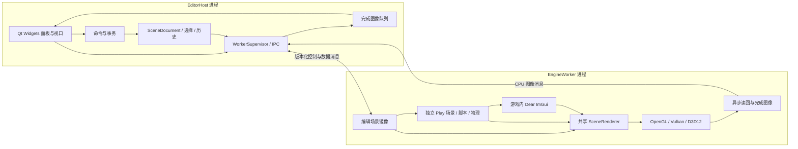

# Qt 6 编辑器目标架构

C# 运行库共享、编译与重启的拟议分工见 [Mono 与游戏发布设计](ManagedScripting.md)。
该脚本方案尚未实施；当前 Worker 仍禁用脚本，Host 不加载 Mono。

版本：2026-10-24 目标设计。状态：**E0.1–E1.2 Qt、引擎预览、项目浏览、草稿多标签与 E1.4 选择服务已实现，完整目标架构待实施**。

## 当前实施：E0.1 基础原型

E1.9 资源导入：Project > Import resource 选择源文件和项目 Assets 内目录，
Host 异步运行原生 GEngineTools import-resource，以现有 GAsset schema 写入新资源。
源文件保留，不覆盖现有目标；Host 校验目录边界，工具检查格式/大小/链接。
临时输出完成后以禁止覆盖的重命名发布，失败清理临时文件。导入期间禁止切换/
关闭项目及打包；窗口关闭等待作业完成。成功刷新并选择目标，失败写入 Console/
状态栏。Host 不链接引擎，不改变 GPU/IPC；当前只封装源数据，不解码或收集依赖。
Host 的内置字体 Base64 读取显式转为 Latin-1 字节，保持字体加载语义并兼容 Qt 类型要求。

E1.7 项目设置（2026-10-28）：.gproject 的可选 settings 对象保存
项目根相对 defaultScene，Host 在打开项目时选择该场景并更新独立 Worker；
未设置/缺失场景清空项目视口、停止 Worker，并保留项目以便修复设置；不退回
引擎示例。Project settings 原子保存校验后的项目内路径，再选择该场景；Cancel
或失败保存保留旧文件/视口。新项目创建空 Default.gscene 并设置默认路径。
关闭项目清空其场景，普通目录浏览入口仍保持原有独立视口行为。
原生导出器兼容该元数据但不改变游戏原生启动入口，打包偏好仍在本机。
引擎渲染 API、GPU 所有权和 IPC 不变；跟踪见 TODO/EditorArchitecture.md E1.7。

E1.8：Example 下七个示例均有同名 .gproject 和默认场景。FrameGraphTriangle
保留颜色场景，其余提供空编辑器起点，避免隐式运行 C++ 工作负载或加载不支持
组件的历史场景；见 Example/README.md。引擎架构、IPC 和构建发现规则无变化。

2026-10-26 E1.6/S2.4：`.gproject` 是 schema 1 JSON 项目描述，只记录版本和
项目名称（E1.7 新增可选 settings.defaultScene）；**不记录任何打包信息**。
整个 packaging 对象及 EXE 路径已移除。
项目根是描述文件所在目录。Host 的 ProjectFile 负责有界读取/版本校验和
QSaveFile 原子保存；打开失败保留旧项目，目录浏览仍作为兼容入口存在。
File 提供 New/Open project，项目菜单提供一个打包入口与作业取消；打包窗口
提供输出目录、可执行名和可选 Logo 输入，自动 Release 构建 src 与引擎，再归档并发布单入口分类
布局。

输出目录、可执行名与 Logo 由 Host 在打包对话框选择，单独保存至本机 QSettings，
以 canonical 项目路径摘要区分；更换机器/移动项目后重新选择或采用默认相邻输出目录和项目名。
这些偏好不修改项目文件。命令行 `GEngineTools.exe export-project` 的 --output 为独立必填参数，
--executable-name 与 --icon 为可选部署参数，不会从项目内容读取；项目不指定已有 EXE，
不能靠复制旧构建代替编译。Host 将支持的图像 Logo 渲染为多尺寸 `.ico` 临时文件，
仅把该资源交给原生导出器。

Logo 临时文件由 Host 拥有，在切换/关闭项目或替换 Logo 时销毁。导出器把
图标按内容哈希更新到项目构建缓存中的固定路径，避免临时路径变化导致重复
链接；清空 Logo 显式清除 CMake 图标参数，后续包不继承旧资源。此流程不改变
引擎 GPU 资源所有权、后端接口或 IPC。

Host 用异步 QProcess 调用随编辑器部署的原生 GEngineTools 工具，参数逐项传递，
不通过 shell 拼接命令；Console 显示有界输出，重复打包/项目切换在作业期间
禁用。退出先确认草稿，再终止自己启动的导出器，等进程退出后继续 Worker
关闭。30 分钟期限和取消只影响该 Windows Job 中的打包/编译进程树；不会杀
用户其他构建或游戏进程。
导出器使用项目互斥与 DeleteOnClose 发布锁；进程退出后系统释放锁，未完成
staging 可能保留。目标目录切换失败尝试恢复旧目录，变化的旧版本留在相邻
备份目录；目录替换不宣称原子，切换瞬间终止可能需从备份恢复。编译/归档
失败不丢弃旧包或草稿/项目状态。

当前流程从源码编译 EXE/DLL，将 Assets（排除 Cache）/Licenses
合为 .gpak，输出没有原始 Assets 或脚本启动器。原生入口校验并挂载资源索引，
资源按需读取；Config/Config.ini 和 Cache/Shaders/<后端>/ 直接保存在游戏根目录，
日志和用户状态也在根目录下，重新打包保留这些目录；不再整包展开。
源码 SDK 供编辑器编译使用，不是玩家依赖。原生资源包 API
新增于 Runtime；GPU API/IPC 不变。当前不支持 C#/Mono、压缩/加密、资源
格式转换、场景文档编辑或自动原生依赖解析。
项目和 UI 打包验收见 TODO/EditorArchitecture.md 与 TODO/ScriptingAndPackaging.md。

2026-10-26 Console 保留引擎日志颜色：EngineWorker 在创建 Runtime 前，仅将
自己的两个 spdlog 控制台 sink 替换为始终输出 ANSI SGR 的 stderr sink，沿用
原 Windows 级别配色（白/青/绿/亮黄/亮红/亮白红底）。引擎公共日志接口、
游戏日志行为和文件 sink 不变，stdout 继续仅承载二进制协议。
WorkerSupervisor 将原始 stderr 字节交给 ConsoleOutput，后者增量解码 UTF-8
与 SGR，使用 QTextCursor/QTextCharFormat 插入纯文本；颜色序列不进入复制文本，
日志中的 HTML 按字面显示。普通 Host 诊断使用默认颜色。Console 使用深色背景，
上限 300 个文本块、每行 16 Ki 字符、SGR 参数 64 字符；超限文本截断但继续解析。
退出时先排空 stderr，再重置流状态；新进程启动也重置，保留已有历史。
支持 16 色前景/背景与粗体/复位，不执行光标移动等终端控制；不模拟完整终端，
不读取或复现用户自定义 Windows 控制台调色板。日志流不改变 GPU 或场景所有权。

2026-10-26 浏览器标签样式直接应用到 Qt 原生停靠组，不再提供重复的全局面板导航。
默认使用多面板分割布局：左侧 Hierarchy/Assets，中间 Viewport/Console，右侧
Documents/Inspector 标签组。各组顶部原生 QTabBar 使用深色圆角/活动高亮，
提供 × 隐藏面板与末标签右侧 + 菜单，选择面板将其加入当前组并激活。
紧凑样式采用上下 3 逻辑像素留白、20×20 按钮与 6 像素圆角，默认标签高度约
26 逻辑像素；高度仍随字体/DPI 由 Qt 计算，未固定裁切文字。
Qt 自己拥有标签、排序、拖拽、分组、浮动与布局恢复；Host 只设置样式与
tabButton，不修改 Qt 的 tabData 或标签列表。面板标题在此原型中固定且唯一，
用于将原生标签解析为对应 dock；增加可重名/动态标题的面板前需替换此映射。
应用事件过滤在布局/显示/尺寸改变后合并安排刷新，分组重排后重新绑定按钮，
按钮用 QPointer 防止引用已销毁面板；析构前移除事件过滤。
单面板区域保留原生标题拖拽入口，标签化后显示浏览器标签；View 可重新打开隐藏面板。
窗口保持原生系统标题栏。本次不涉及自绘系统窗口控制与标签拖出创建新文档。

草稿文档标签栏移入 Documents，提供新建 +、关闭、排序、溢出滚动和路径提示。
BrowserDocumentTabs 同步 QTabWidget 页面/顺序，内部标签栏隐藏；隐藏或浮动
Documents 同时隐藏或带走该文档栏。Ctrl+T/Ctrl+N 新建草稿，不创建引擎进程。
Documents 内容容器仍是可关闭、重排页面的 QTabWidget，
每个 QWidget 页面独占 DraftDocument、文本控件、路径与未命名编号；使用页面
身份关联状态，不以可变化的标签索引作为文档身份。新建/打开新增标签，同一
规范化路径（Windows 大小写不敏感、解析文件符号链接）聚焦已有标签，保留
尚未保存的编辑，不能用再次打开隐式重载。每页历史/保存点独立，撤销/保存只
作用于当前页。最多 32 页，每页仍保留 64 KiB 文本与 256 状态限制。

关闭页提供 Save/Discard/Cancel，取消不删除页；最后一页关闭后新建一页草稿。
退出逐页确认，所有确认完成前不删除任何页、不停止 Worker；中途 Cancel
恢复原活动页，已明确保存的页面不会回滚磁盘保存。确认期间防止关闭重入，
通过后禁用窗口再异步停止 Worker。删除页/窗口析构前断开相关回调，避免访问
已释放的文档状态。另存为拒绝覆盖另一已打开标签的路径，失败保留保存点。

此扩展仅是 .gedraft 多文档，不提供场景多文档、独立游戏会话、文档拖出窗口
或跨窗口移动。六个工具面板与单 Worker 仍共享一个主窗口；标签内容、文件路径
和顺序不写入布局 QSettings，启动仍为一页新草稿。引擎 API、项目目录、IPC、
渲染接口与 .gedraft 格式不变。退出取消、重排、重复打开与后台页故障恢复纳入
恢复检查，完整 SceneDocument 和 E2 事务仍待后续实施。

2026-10-25 E1.1：新增项目目录与只读资源工作区。Core/ProjectContext 只依赖
标准 C++ filesystem，拥有 canonical 根目录与 generation；Host/ProjectWorkspace
以 QFileSystemModel/QTreeView 延迟枚举该目录，Inspector 展示选中文件/目录的
相对路径、类型、大小和时间。打开失败保留旧项目/选择，切换或关闭清除选择。
选择按 canonical 路径检查根目录边界，浏览器隐藏符号链接，不读取/执行资源内容。
2026-10-31 资源显示约束：Assets 树保留全部目录用于导航，文件条目仅限
`.gasset` 与 `.gscene`；原始兼容源格式保持隐藏，须先经 Import resource
导入。该过滤属于 Host 投影，不改变磁盘内容、加载器兼容输入或项目 schema。
250 ms 定时校验处理资源删除与项目目录丢失；新模型/selection model 在切换时
释放。Qt 自带文件系统枚举/监视由模型管理，未建立全项目导入或文件哈希服务。

2026-10-26 E1.4：Core/SelectionService 成为资源选择的权威状态。它保存
ProjectContext generation 与项目内相对资源 ID，不保存 QWidget、模型索引或
canonical 绝对路径；Assets 树和 Inspector 只做投影与元数据展示。切换/关闭
项目通过 generation 失效，资源删除通过 Validate 失效，空 scope/id 拒绝。
ProjectWorkspace 在边界检查通过后写入服务，并把相对 ID 映射回项目内路径
用于模型恢复与 250 ms 校验。该拆分为后续 SceneDocument/对象选择服务保留
同一 generation + ID 失效规则，但尚未实现对象选择、命令事务或 Worker 同步。

Assets/Inspector 是可停靠面板，View 或停靠组 + 菜单可重新打开。
布局版本升级到 4，旧版本布局不自动恢复，首次采用多面板分割默认布局。
新的分割/浮动布局和组内标签顺序由 Qt 布局保存恢复。
项目仅为用户选择的目录，本轮不创建项目清单、修改 cwd、
保存上次项目路径或把目录视为资产数据库。草稿与静态引擎预览独立于项目，
关闭项目不清空草稿或重启 Worker；Worker 崩溃不丢失项目选择。
SceneDocument、导入、组件 Inspector、运行场景同步与 Mono 仍未接入；本次
没有引擎公共 API、渲染接口、IPC 或 .gscene 格式变更。远程/超大目录的取消
响应和长时文件监视资源增长尚未验证，不能以小型临时目录测试代替。

以下为 2026-10-25 E0.2 历史实现；固定三角形传输已由下文 E4.1 替换。
E0.2 新增 GEngine-EditorEngineWorker，链接 GEngine 而不链接 Qt。
正常启动默认连接此子进程；诊断模式仍由 --self-test 或 --worker 显式选择。
真实 Worker 通过 Application 兼容入口创建 EngineRuntime（Shader 缓存仍依赖
Application 单例），创建离屏 RenderGraph 与持久管线，渲染青色三角形，
复制到单层 RGBA8 纹理数组后复用 ReadLayerData，在子进程内同步等待 GPU。
首版固定 160×90、约 2 FPS（每次 Ping 请求一帧），用于接通真实 GPU 输出；
不是最终高分辨率视口或 Scene 编辑。同步读回是低频预览的临时路径，后续异步
读回/共享内存仍在 E0；Qt 主线程不等待 GPU。原生表面在 Worker 内隐藏。
协议 stdout 专用句柄与日志分离：引擎 stdout 转到 stderr，再由 Host Console
异步接收；Host 不加载 GEngine。启动截止延长至 30 秒，给设备/着色器初始化留时间。
图像附带明确 EngineFrame 类型并归一为顶部起始；诊断图案仍标记为 CPU 图像。
首个引擎帧前心跳使用 10 秒宽限，允许首次原生管线创建；收到图像后恢复 2 秒。
引擎公共 API 未改变，三后端验证与剩余工作见编辑器 TODO。
当前预览已分别通过 OpenGL/Vulkan/D3D12 的 Debug/Release 像素、方向、日志与
故障恢复检查；CMake/Premake 两配置均通过。D3D12 短时 101 帧工作集观察在
预热后稳定约 128 MiB；长期 GPU 显存、场景操作和大帧性能不在此次验证范围。

`Host`、`Core`、`Protocol`、`Worker`、`Tests` 目录已独立于旧 `src` 编辑器建立。
GEngine-EditorHost 只链接 Qt6 Core/Gui/Widgets，不加载引擎；
GEngine-EditorDiagnosticWorker 是无 Qt/无 GEngine 的协议诊断子进程，**不是
EngineWorker 实现**。它提供握手、心跳和 CPU 方向图案，不能作为场景或任意
图形后端的渲染验证。真正的 Scene 镜像、Play、场景渲染和 Qt Gizmo 仍未实现；
上面的 E0.2 提供独立 GPU 三角形预览。

布局中的 Hierarchy、Document、Console、Viewport、Assets 与 Inspector 均为 QDockWidget，无固定
中央视口。所有面板允许全区域停靠、浮动、关闭、分割和标签化；View 菜单
提供显隐动作和 Reset layout，工具栏也可移动/浮动/隐藏。布局状态版本为 4，
不兼容的旧布局回落到默认布局，geometry 仍独立保存；关闭面板不删除内容、
文档或 Worker。此变更不影响引擎 API 和协议。

Host 使用 QMainWindow/QDockWidget、Qt 主线程上的 QProcess 异步收发与定时
截止时间；缺失/崩溃/协议错误使其断连，挂起显示 Unresponsive，用户可停止并
重新启动。正常停止异步等待 1.5 秒后终止所属诊断进程；最终析构有 2 秒的
kill/wait 回收兜底，正常帧无阻塞等待。心跳每 0.5 秒请求，2 秒无回复判超时，
启动握手截止 30 秒。大帧解析线程、流量调度和完整资源预算仍属后续 E0/E4，
不能把小图像诊断接收器用于无限日志/不可信流量。

`DraftDocument` 提供 Host 独立草稿与最多 256 个历史状态。Qt 文本控件关闭
自己的 Undo，核心历史管理保存点；原子写 `.gedraft`（格式名
GEngine.EditorDraft、version 1、notes）。它是明确标识的实验性笔记文件，
不解析/保存 `.gscene`，不代替正式 SceneDocument。失败保存/打开保留当前
内容和历史，草稿限制 64 KiB UTF-8，读取文件最大 1 MiB。UI 布局用独立的
QtEditorHostPrototype 设置保存，不触碰旧 imgui.ini。

诊断协议 v1 使用 32 字节小端头及最大 64 KiB payload；尚无文档 revision、
镜像事务或大帧分块。诊断图像固定 128×80 RGBA8，Host 验证尺寸/stride 后
复制 QImage 存储。实际字段和命令见 [E0.1 API](../API/QtEditor.md)。

SDK 脚本在 build/qt6 与 dist/qt6 分别构建/安装 Debug/Release Qt。保留 Qt
OpenGL 支持以满足当前 Windows 插件源码构建条件，但原型视口仍为 CPU 图像，
不共享引擎设备。windeployqt 部署运行库，并携带 offscreen 测试插件及现有
Noto 字体/OFL。启动命令见 [编辑器 README](../../GEngine-Editor/README.md)。

以下为完整目标设计；与原型有差异处是后续工作，不是已提供的能力。

本文件是新编辑器的目标架构入口，整合并替代 [旧方案](Editor.md) 中的目标
设计；旧文件保留当前 ImGui 编辑器的事实与设计历史。实施任务统一由
[编辑器 TODO](../../TODO/EditorArchitecture.md) 的 E0–E6、E4-G 管理，
协议和模块契约见 [Qt 编辑器 API 设计](../API/QtEditor.md)。本文不授权额外实现。

## 1. 已确定的方向与当前基线

| 决策 | 目标 |
| --- | --- |
| 编辑器界面 | Qt 6 Widgets，负责全部编辑器窗口、面板和视口工具。 |
| 游戏界面 | Dear ImGui，在游戏/EngineWorker 内执行与绘制。 |
| 故障边界 | EditorHost 与 EngineWorker 分进程；引擎崩溃后编辑器仍可编辑、撤销、保存与重启引擎。 |
| 场景权威数据 | Host 文档模型；Worker 场景只是可重建镜像。 |
| 视口传输 | 首版传输已完成 CPU 图像，Qt 独立显示，不跨进程共享 GPU 对象。 |
| 变换工具 | Qt Host 实现，功能验收后移除 ImGuizmo，不在 Qt Host 嵌入 ImGui。 |
| 初始范围 | 单项目、一个所属 Worker；E1.2 支持草稿多标签，场景多文档、插件 ABI、协作编辑和零拷贝仍不在首轮范围。 |

2026-10-25：旧 ImGui 编辑器及 GizmoController 已按用户要求移除，源码与
资源可从 Git 历史查看。当前仅支持 Qt Host/Worker；完整 Scene/Play/Gizmo 尚未迁移。
ImGuizmo 已无构建使用方，聚合仓库内源码指针暂保留。

Qt `qtbase` 源码已固定在 `GEngine/GEngine-ThirdParty/qtbase`：v6.10.3，
`7ddbc87d8e14ce51d2957ea72d0a6077593d5ff4`，包含 Core/Gui/Widgets。
源码统一存放在聚合仓库不意味着引擎依赖 Qt；Qt SDK 构建、Host 原型与基础
部署及真实引擎预览 Worker 已提供，场景 UI 尚未实现。旧编辑器的历史构建/
运行记录不能作为 Qt 编辑器的验证结果。

## 2. 进程、构建目标与依赖

计划形成三个目标，名称可在实现时按仓库惯例调整：

| 目标 | 直接依赖 | 禁止依赖 |
| --- | --- | --- |
| EditorHost | Qt6::Core/Gui/Widgets、EditorCore、协议编解码适配器 | GEngine DLL、用户原生脚本、ImGui/ImGuizmo、引擎 Platform 头 |
| EditorCore / Protocol | 标准 C++ 数据类型、文档与命令逻辑；共享协议结构与测试向量 | QWidget、QObject 生命周期、引擎 Scene/GameObject、GPU 原生对象 |
| EngineWorker | GEngine、Dear ImGui、Worker 协议适配器 | Qt Widgets、编辑器面板、Host 文档对象 |

不把 Qt 类型、`Ref<Scene>`、ImGui ID 或矩阵对象的内存布局作为协议。
矩阵按固定元素顺序编码并标注约定；Host 可有独立数学实现，不为数学函数加载
引擎 DLL。运行时引擎不反向依赖编辑器，普通游戏构建无需 Qt 安装。

Qt/系统故障可能影响 Host；本设计保证的是引擎进程故障不直接破坏 Host
地址空间。GPU 驱动重置和 Host 自身缺陷需要单独验证，不能以进程隔离替代。

## 3. Host 模块与所有权

EditorSession 协调项目、文档、运行会话和服务，Qt QObject 父子关系仅管理 UI
对象，不能代替文档所有权。EditorCore 不依赖 Qt，Qt adapters 负责信号和控件。

| 模块 | 权威状态与职责 |
| --- | --- |
| ProjectContext | 项目根目录、资源/缓存路径及项目 generation。 |
| SceneDocument | 对象/组件数据、持久 ID、路径、revision、保存点；不推进脚本和物理。 |
| CommandService / History | 验证修改、执行/撤销/重做、拖动事务、dirty 状态。 |
| SelectionService | 文档限定的对象/资源 ID，删除或换文档时立即失效。 |
| PlaySessionProxy | 用户运行意图与 Worker 已确认状态，运行实例快照。 |
| WorkerSupervisor | 子进程、连接 generation、异步请求、超时与重启。 |
| ViewportController | 相机、图像区域、DPI、输入捕获、Qt Gizmo 与视图 revision。 |
| AssetService / Diagnostics | 导入请求、可提交资产结果、结构化错误与日志。 |

对象引用包含 DocumentId、DocumentGeneration、ObjectId。当前 Scene 有
uint32_t UUID 路径，但查询、复制与序列化一致性仍需实现阶段核对；不能假定
已有完善的稳定引用系统。运行对象另带 SessionGeneration，不能用同一 UUID
把运行实例误解析为编辑对象。面板不持久保存 GameObject 或组件引用。

## 4. Qt 界面结构

QApplication 驱动 Host 事件循环，QMainWindow 管理菜单、QToolBar、状态栏与
QDockWidget；中间为 Scene/Game 视口，其他面板可停靠或浮动。

| 面板 | 数据来源与交互 |
| --- | --- |
| Hierarchy | Qt Model/View 展示文档对象，搜索和选择经 SelectionService。 |
| Inspector | 类型化属性控件/delegate，修改经 CommandService，不直接写 Worker。 |
| Assets | 项目资源查询、导入状态和拖放意图，不由控件自行改路径或加载引擎资产。 |
| SceneViewport | Worker 编辑镜像图像 + Host 相机/选择/Gizmo 覆盖层。 |
| GameViewport | Worker 运行图像及游戏 ImGui，仅聚焦时接收游戏输入。 |
| Console / Diagnostics | 区分 Host、Worker、脚本与后端日志，提供来源和关联请求。 |

QAction 的菜单、快捷键、工具栏共用一份命令与可用性判断。Qt item model
只是文档的投影；delegate 必须提交编辑命令。只保留 EditorCore 的历史，不
并行维护独立 QUndoStack。Qt UI 修改在主线程，后台解析结果经 queued 通知
回到主线程。布局独立保存 geometry、dock state 与版本；不把旧 imgui.ini
转换为 Qt 布局，也不改动用户已有布局。

## 5. 文档、撤销与磁盘保存

SceneDocument 是 Worker 断连时仍可保存的独立模型，不能把保存实现成 RPC。
新建/打开先产生候选文档，验证通过后才替换；打开失败不破坏旧场景。Host
需要独立的文档编解码适配器，保留现有 `.gscene` 中的未知字段/组件。
现有 Serializer 依赖引擎 Scene，不能直接搬入 Host；E1 通过往返样本验证
兼容性，不在本设计中切换文件格式。遇到无法保留的数据必须拒绝破坏性保存。

命令保存可拥有的目标标识、前后值和逆操作数据。删除/组件移除需要可恢复
快照及引用关系；创建的重做须恢复相同 ID 或明确修正引用。验证失败不留下
半个变更，也不进入历史。新命令截断 redo 分支，保存点按历史状态标识记录。

连续交互采用 Begin → Preview → Commit/Cancel：文档可实时更新，松开后只
追加一个历史条目；Escape、失焦、删除目标、换文档或进入 Play 取消事务。
预览变更也带单调同步 revision，Cancel 发送恢复状态；历史保存点与同步
revision 分开，避免撤销/取消导致 Worker 顺序倒退。

保存使用同目录临时输出，写入与检查成功后替换原文件；失败保留原文件和
保存点。新建、打开、切项目、退出统一处理 Save/Discard/Cancel。导入与
外部重新加载形成显式历史屏障，不暗中清空或伪造撤销记录。

## 6. Worker 与运行状态

Worker 在自身合法线程将文档 DTO 转为编辑 Scene 镜像，在安全帧边界应用
修改。场景初始化、脚本、物理、资产引擎解析和 shader 编译均在 Worker，
不在 Host 动态加载可执行引擎代码。资产导入到临时位置，成功后 Host 才提交
引用；崩溃产生的半成品不替换项目正式资源。

进程连接状态和游戏状态分开：

| 状态机 | 状态与规则 |
| --- | --- |
| WorkerSupervisor | Stopped → Starting → Ready；失败/退出变 Disconnected，超时变 Unresponsive；重启创建新的 generation。 |
| PlaySession | Edit → StartingPlay → Playing ⇄ Paused → StoppingPlay → Edit；只在 Ready 时可请求启动。 |

Play 以已确认同步的文档 revision 创建独立运行 Scene，启动成功才返回 Playing。
暂停同时停止游戏逻辑与物理，呈现继续；Stop 在 Worker 清理脚本/物理与运行
引用。现有 Scene 没有完整显式停止契约，E3 必须核实部分初始化和析构路径。
首轮不提供未验证的单步或“应用运行变化回编辑场景”。

Play 时编辑文档默认只读，Inspector 明确标识运行实例；运行属性请求不进入
文档历史，Save 始终保存编辑文档。Worker 崩溃后取消运行状态、恢复编辑能力，
重启只恢复编辑镜像，不自动恢复游戏执行或继续发送旧输入。

## 7. IPC 与镜像一致性

首版使用 QProcess 的异步 stdin/stdout 管道：stdout 只输出协议，日志使用
stderr，避免日志破坏帧边界。编解码独立于 QWidget，不在 GUI 线程进行大图
解析或同步等待进程；禁用 UI 路径的 waitForFinished/waitForReadyRead。

消息使用版本化长度前缀，字段明确编码，禁止直接 memcpy C++ struct。
控制 payload 可用 UTF-8 结构化数据，图像使用二进制分块，不使用 base64。
头部至少包含协议版本、消息种类、SessionGeneration、RequestId、DocumentId/
Generation、revision、payload 字节数。完整字段与错误契约见配套 API 文档。

握手核对 protocol/build ID、后端与能力及资源上限后才允许加载文档。
LoadSnapshot 成功 ACK 后增量 ApplyEdits 必须匹配 base revision；不匹配则
请求完整重同步，不能假定漏掉的修改已生效。ACK 表示应用成功，Ready 表示
初始化成功，FrameReady 表示对应图像完成，三者不能互相替代。

每个请求有截止时间；重复 RequestId 在同一会话不得重复执行模型变更，
跨会话的结果直接丢弃。命令不能因掉线后重发而创建两次对象。控制队列有界，
图像分块间优先发送控制消息；流量积压时丢旧图像，不丢已接受的文档命令。
如果命令队列不能继续接收，则标记镜像需完整重同步，Host 文档仍接受编辑。

### E4.1 实时场景连接（2026-10-28）

TODO/EditorArchitecture.md 的 E4.1 把共享 SceneRenderer 组件录制接入 Worker
离屏图。Host 每 33 ms 最多请求一帧，目标按可见视口/DPI 尺寸并限制到 1280×720；
隐藏时暂停、旧尺寸结果丢弃，心跳独立。最多一帧在途，图像分成 64 KiB 包，
Host 增量解析并复制最终 QImage；不跨进程传递 GPU 句柄。同步读回暂留 Worker，
上一帧读回完成后才可能收到下一次替换请求，复用既有 GPU 完成路径。
File > Open scene for rendering 重启子进程并传入绝对 .gscene 路径，保留 Host 草稿。
当前读取 GameObject 基础数据及 ImageComponent、StaticMeshComponent、CameraComponent。
复用 Serializer 的资源路径/材质 shader 与名称加载；缺失 ImageComponent 材质时
提供引擎默认采样材质。CameraComponent 保持数据/投影行为，不新增自动相机渲染。
不支持的组件明确失败。无文件时是标记清楚的引擎示例 Scene，含动态变换对象。
任意材质属性序列化、Play 和异步读回仍开放；GPU/IPC 契约不变。

## 8. 视口与 GPU 生命周期

Worker 的 SceneRenderer 同时服务 Scene 与 Game 请求，保持相同材质语义。
现有组件帮助绘制与 presentation 绑定，E4 需要先补目标无关的场景渲染契约；
不能将旧颜色预览标成完整材质渲染，也不能为 Qt 单独复制一套场景 renderer。
图形接口继续经过 RenderSystem/RenderGraph/RenderDevice，原生对象留在后端。

Scene 图像不含编辑器控件；Game 图像在场景之后合成游戏 ImGui。GPU 依赖为
场景写入 → 可选游戏 UI 合成 → 读回 → GPU 完成 → 图像消息。录制/提交必须
保留资源到所有引用队列的提交 serial 完成，不依赖 CPU 析构或 fence 句柄复用。
resize 先创建替代目标，再退休旧目标；零尺寸/隐藏视口暂停请求，恢复时重建。
正常帧不引入设备级等待来掩盖生命周期错误。

首版 Host 消费已完成 CPU 图像，用 QWidget/QPainter 绘制 QImage。协议统一
约定顶部起始行、RGBA8、明确 stride、色彩空间和 alpha 约定；Worker 负责
后端方向/格式转换，Qt 不再通过引擎 GUIUtils 获得纹理 ID。图像携带 ViewId、
FrameId、DocumentRevision、CameraRevision 与尺寸，Host 丢弃旧会话/旧 resize
generation 的图像，并在镜像落后时显示同步状态。

起始上限提议为单图像 64 MiB、单块 64 KiB、每视口最多两份完成图像；在
握手中协商更小的可用值。计算宽高/stride 时先做溢出检查，收到超限、缺块
或失联的半帧直接丢弃。发送端只读回/发送预算内图像，接收端保留最新帧；
排队通知也须合并，不能只限制底层缓冲却累积无限 Qt 事件。

该路线有 CPU 拷贝、带宽和显示延迟成本；先测量三后端的可用表现。跨进程
共享纹理、原生窗口嵌入和 shared-memory 优化另需设计，不属于首轮承诺。

## 9. 输入、坐标与 Qt 变换工具

Host 输入优先级：模态对话框 → 文本/输入法 → 活跃 Gizmo → 已捕获视口 →
全局命令。鼠标捕获持续到释放；失焦、掉线或视口关闭释放所有按键/按钮，
防止游戏卡在按下状态。GameViewport 只在聚焦时转发输入，Worker 先交给
游戏 ImGui，再按 capture 状态决定是否交给游戏逻辑；Qt 不运行游戏 UI。

坐标转换链为 Qt 逻辑坐标 → 图像内容区域（扣除 letterbox）→ 物理像素/
归一化坐标 → 相机空间。DPI 只换算一次；命中测试与绘制使用同一内容矩形
及相机版本。旧图像与新相机不匹配时，不对旧像素执行拾取。首轮以树选择为
基线；GPU ID 拾取必须有明确的输出/异步读回能力，不能同步等待 GPU。

Qt Host 的 Gizmo 支持移动、旋转、缩放，Local/World、轴/平面约束和吸附，
使用命令事务。网格与手柄绘制/命中测试共享数学结果，验证近裁剪、透视/
正交、DPI、resize、缩放退化和取消恢复。首版覆盖层若无深度数据，应明确
采用可见覆盖方式，不宣称实现了按场景深度遮挡。

旧 GizmoController 与构建/include/Dependencies.lua 条目已随旧编辑器删除。
Qt 工具交互与撤销仍待 E4-G 验收；ImGuizmo 子模块后续清理需先发布聚合仓库，再更新
主仓库指针；保留历史提交，Dear ImGui 游戏依赖不随之删除。

## 10. 故障处理与关闭

| 故障 | Host 行为 |
| --- | --- |
| Worker 启动失败/版本不匹配 | 显示明确诊断，不发布 Ready；编辑与保存继续。 |
| 原生崩溃/abort/管道 EOF | 完成待决请求的失败结果，丢弃半帧，保留最后图像并覆盖断连提示。 |
| Worker 挂起 | 心跳/请求超时显示 Unresponsive，不阻塞 Qt；允许终止所属 Worker 并重启。 |
| 解析或图像协议错误 | 拒绝无效数据、断连或重同步；不把 Worker 数据当作可信本地对象。 |
| 后端设备丢失 | Worker 尽可能报告设备错误；Host 保留文档，独立呈现或无视口保存仍可用。 |

重启先清空会话专属请求、输入、运行选择与图像，再握手并发送最新完整
文档。禁止以运行副本覆盖 Host 文档，历史与保存点保持。正常关闭先处理
未保存修改，再发 Stop/Shutdown；有限等待后仅可终止自己启动的子进程，
回收管道、进程句柄和图像队列。Host 不调用崩溃 Worker 的清理函数。

## 11. 目录与构建迁移

建议在 `GEngine-Editor` 下分别组织 `Host`、`Core`、`Protocol`、`Worker`
目录；UI、文档核心和 Worker 不再由一个 EditorLayer 统包。通用引擎能力
仍在 `GEngine/include/GEngine` 与对应 `GEngine/src/GEngine`，不能迁入编辑器
目录来绕过架构边界。目录与目标创建归 E0/E1/E6，不在本文修改现有文件布局。

Qt SDK 从固定 qtbase 源码单独构建/安装到输出目录，不能将生成文件写回
第三方工作区。CMake 的 imported Qt targets、Qt 生成工具、Premake 配置及
部署平台插件需匹配同一 SDK/编译器 kit；Debug/Release 分别验证。默认
引擎/游戏目标不查找 Qt、不部署 Qt。当前 Qt 源码添加仅验证了原生成路径。

## 12. 实施与验收

| 阶段 | 最小交付与退出标准 |
| --- | --- |
| E0 | Qt Host + 最小 Worker 连接/断连/重启；故障注入后 Host 仍响应且可保存独立文档。 |
| E1 | 文档、选择、Qt 面板及兼容保存；打开/取消/写盘失败与未知字段往返不丢数据。 |
| E2 | 命令、事务与输入路由；创建/删除/复制/组件/属性往返，一次拖动一次撤销。 |
| E3 | 独立运行副本，Play/Pause/Resume/Stop 与初始化失败回滚，重复循环资源可回收。 |
| E4 / E4-G | 三后端离屏图像、DPI/方向/resize 与 Qt Gizmo；功能验证后移除 ImGuizmo。 |
| E5 | 项目路径、导入暂存/取消、过期任务丢弃和诊断；切项目/退出不泄漏任务。 |
| E6 | CMake/Premake、部署、移除旧编辑器依赖；独立游戏 ImGui 示例仍运行。 |

E0 必须先用最小协议和图像验证进程边界，再扩展控件；不同时重写引擎 renderer。
每阶段更新 owning TODO 的证据和阻塞项，表格不另建一份完成清单。
通用 SceneRenderer 或其他公共渲染接口变更必须同步提供实际调用新接口的
Example，记录启动、可见结果、resize/替换/退出和逐后端能力；Qt 壳程序不
替代引擎接口示例。

回归范围包括：不对称图形与文本方向、真实 resize/最小化/恢复、Qt 焦点与
输入法、Gizmo 拖动取消与撤销、Play 循环、保存失败、Worker 初始化/渲染/
导入阶段的访问冲突或 abort、挂起、截断包、旧回复和重复请求。OpenGL、
Vulkan、D3D12 在 Debug/Release 分别记录可见结果、验证日志、进程/句柄/
图像内存与 GPU 资源增长。编译或有界正常退出不能替代交互、故障与长期检查。

E0.1 不改变当前公共引擎 API 或 `.gscene` 格式；后续实施须同步契约、示例
和验证记录。真实 EngineWorker、场景编辑/运行与后端视口仍待实施。
